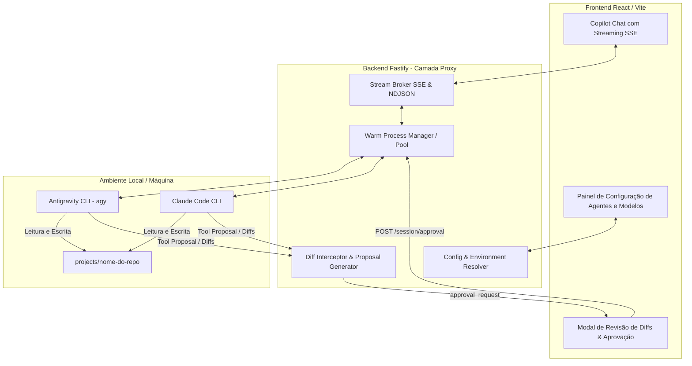

# 🚀 Plano Diretor: Arquitetura de Proxy de Agentes (Agent Harness & Enterprise Memory)

> **Documento de Governança, Rastreamento e Fonte de Verdade Arquitetural**  
> *Este documento define a arquitetura para operar o software como um **Proxy de Agentes Local**, com alta velocidade (warm sessions, streaming SSE), parametrização completa para o usuário, governança de memória viva nos repositórios e fluxo de aprovação visual human-in-the-loop, garantindo portabilidade em qualquer computador.*

---

## 📌 Status Geral de Execução

| Fase | Título | Status | Dependências |
| :--- | :--- | :---: | :--- |
| **Fase 1** | Harness de Alta Velocidade, NDJSON & Streaming SSE | 🟢 **Concluído** | Nenhuma |
| **Fase 2** | Painel de Configurações, Parâmetros de CLI & Auto-Discovery | 🟢 **Concluído** | Fase 1 |
| **Fase 3** | Interceptor de Alterações, Visualizador de Diffs & Aprovação Visual | 🟢 **Concluído** | Fase 1, 2 |
| **Fase 4** | Padronização de Memória nos Repositórios (`.spec-memory`, `.dictionary.json`) | 🟢 **Concluído** | Fase 2, 3 |
| **Fase 5** | Validação de Portabilidade, Testes E2E & Empacotamento | 🟢 **Concluído** | Fase 4 |

*Legenda: ⚪ Não Iniciado | 🟡 Em Andamento | 🟢 Concluído / Validado | 🔴 Bloqueado*

---

## 🛡️ Princípios Invariantes da Arquitetura

1. **Desempenho Sem Cold-Start (Sub-Second Latency):**
   * Reduzir a latência percebida para menos de 1 segundo através de streaming SSE em tempo real de tokens e eventos de ferramentas.
2. **Portabilidade Universal (Zero Code-Changes):**
   * O software descobre automaticamente os binários instalados na máquina (`agy`, `claude`, `aider`) e degrada elegantemente para o Modo Direto (Direct API) com guias claros se nenhuma CLI for encontrada.
3. **Human-in-the-Loop & Governança de Diffs:**
   * Qualquer alteração de arquivo proposta por um agente é interceptada e exibida como um diff visual lado a lado para aprovação explícita do usuário antes de ser persistida.
4. **Isolamento e Rastreabilidade por Repositório:**
   * Cada projeto guarda suas regras, dicionário ubíquo (`.dictionary.json`), memória viva (`.spec-memory`) e skills locais (`.agents/`), permitindo versionamento completo no Git.

---

## 🏛️ Diagrama de Arquitetura

---

## 📋 Detalhamento das Fases de Implementação

---

### 🔹 FASE 1: Harness de Alta Velocidade, NDJSON & Streaming SSE
**Objetivo:** Eliminar o delay de espera em bloco, transmitindo tokens e ações do agente em tempo real para a interface.

- [x] **1.1** Parametrizar opções de performance no `AntigravityAdapter.ts`:
  - Suporte a `--effort (low | medium | high)`.
  - Suporte a `--model <modelId>`.
- [x] **1.2** Implementar consumo de streaming SSE no frontend (`frontend/src/services/api.ts` e `AIContext.tsx`):
  - Conectar ao endpoint `POST /api/chat/stream`.
  - Atualização progressiva do balão de resposta palavra por palavra.
- [x] **1.3** Atualizar o componente de chat para renderizar tokens parciais, timer em tempo real, botão de interrupção imediata (Stop) e logs de execução ao vivo.

---

### 🔹 FASE 2: Painel de Configurações, Parâmetros de CLI & Auto-Discovery
**Objetivo:** Permitir ao usuário parametrizar executáveis, modelos, nível de raciocínio e testar a conexão com 1 clique.

- [x] **2.1** Expandir `server/src/config/storage.ts` para persistir configurações de harness:
  - `cli_settings`: provedor padrão, caminhos customizados, esforço de raciocínio (`effort`), modelo ativo.
- [x] **2.2** Atualizar `SettingsSubView.tsx`:
  - Seção de **Agentes Conectados & CLI Harness (Proxy)**.
  - Detecção visual em tempo real (ex: `🟢 Antigravity Detectado`, `🟢 Claude Code Detectado`).
  - Seletores para Nível de Esforço (`⚡ Rápido / ⚖️ Equilibrado / 🧠 Profundo`).
  - Botão de "Testar Detecção de CLIs".

---

### 🔹 FASE 3: Interceptor de Alterações, Visualizador de Diffs & Aprovação Visual
**Objetivo:** Apresentar alterações de documentos em interface gráfica de diff lado a lado antes de aplicar.

- [x] **3.1** Criar interceptor de proposals no backend quando a CLI emitir modificações.
- [x] **3.2** Conectar o `AgentApprovalCard` ao fluxo de aprovação interativa com suporte a respostas personalizadas.
- [x] **3.3** Despachar confirmações do usuário (`y\n` ou `n\n`) diretamente para o `stdin` do processo.

---

### 🔹 FASE 4: Padronização de Memória nos Repositórios
**Objetivo:** Garantir que o contexto e a memória do projeto sejam armazenados de forma estruturada e portátil.

- [ ] **4.1** Estruturar `.spec-memory/` em cada projeto:
  - `handoffs/latest.md`: Resumo executivo do estado atual.
  - `sessions/`: Transcrições compactadas das conversas anteriores.
- [ ] **4.2** Sincronizar o `.dictionary.json` com as regras em `.agents/rules/` para carregamento nativo nas CLIs.

---

### 🔹 FASE 5: Validação de Portabilidade & Empacotamento
**Objetivo:** Homologar o software para rodar em computadores externos com inicialização rápida.

- [ ] **5.1** Testes em repositórios limpos sem configurações prévias.
- [ ] **5.2** Guia de instalação rápida e documentação dos comandos de inicialização.

---

## 📝 Registro de Decisões e Changelog

* **2026-09-29:** Criação do Plano Diretor de Proxy de Agentes (`docs/AGENT_HARNESS_PROXY_ARCHITECTURE_PLAN.md`). Foco em velocidade via streaming SSE, parametrização rica no painel de configurações e governança human-in-the-loop com visualização de diffs.
