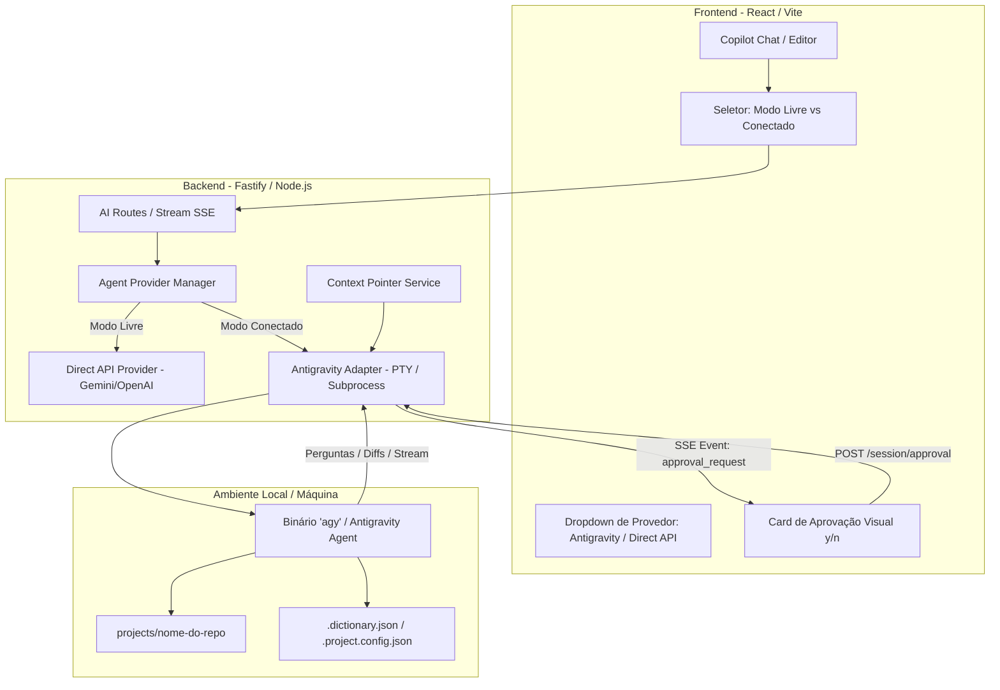

# 🚀 Plano de Implementação: Arquitetura de Agentes Conectados (Agent Harness Multi-Provider)

> **Documento de Rastreamento e Fonte de Verdade Arquitetural**  
> *Este arquivo serve como guia de implementação para conectar o chat a CLIs/Agentes locais já autenticados (iniciando pelo Antigravity / `agy`), mantendo o modo livre direto (API) e operando como um proxy visual com aprovação de ações.*

---

## 📌 Status Geral de Execução

| Fase | Título | Status | Dependências |
| :--- | :--- | :---: | :--- |
| **Fase 1** | Arquitetura de Provedores no Backend & `AntigravityAdapter` | 🟢 **Concluído** | Nenhuma |
| **Fase 2** | Serviço de Orientação de Contexto (`ContextPointerService`) | 🟢 **Concluído** | Fase 1 |
| **Fase 3** | Endpoints de Sessão, Streaming SSE & Controle de Aprovação | 🟢 **Concluído** | Fase 1, 2 |
| **Fase 4** | Frontend: Seletor de Provedor, Chat Híbrido & Modal de Aprovação | 🟢 **Concluído** | Fase 3 |
| **Fase 5** | Testes E2E, Validação de Permissões & Documentação Final | 🟢 **Concluído** | Fase 4 |

*Legenda: ⚪ Não Iniciado | 🟡 Em Andamento | 🟢 Concluído / Validado | 🔴 Bloqueado*

---

## 🛡️ Princípios Invariantes (Não-Negociáveis)

1. **Zero Regressão no Modo Livre (RAW / Direct API):**
   * O fluxo de chat direto via chaves de API existentes (Gemini, OpenAI, Anthropic) continua funcionando normalmente.
2. **Orientação Leve por Ponteiros (Sem Inundação de Contexto):**
   * Como o agente conectado já possui ferramentas de leitura/busca na máquina, o software envia apenas **diretrizes e caminhos de arquivos** (ex: `.dictionary.json`, `.project.config.json`, repositório ativo), deixando a exploração para o agente.
3. **Segurança e Human-in-the-Loop:**
   * Perguntas de confirmação da CLI (`y/n`, execuções destrutivas) são capturadas pelo backend e apresentadas na UI para aprovação visual do usuário.
4. **Padrão Adapter Desacoplado:**
   * Toda CLI/Harness implementa a mesma interface `IAgentProvider`, facilitando a adição futura de Claude Code, Aider, Copilot CLI, etc.

---

## 🏛️ Diagrama de Arquitetura

---

## 📋 Detalhamento das Fases

---

### 🔹 FASE 1: Arquitetura de Provedores no Backend & `AntigravityAdapter`
**Objetivo:** Criar a infraestrutura de tipos, o gerenciador de provedores e o primeiro adaptador conectado para o Antigravity (`agy`).

- [x] **1.1** Criar `server/src/modules/ai/providers/provider.types.ts`:
  - Definidas interfaces `IAgentProvider`, `ProviderStreamEvent`, `ProviderSessionConfig`, `ProviderCapabilities`, `ProviderStatus`.
- [x] **1.2** Criar `server/src/modules/ai/providers/DirectApiProvider.ts`:
  - Encapsulamento das chamadas de `@google/generative-ai` e `openai` na interface de provedor padronizada.
- [x] **1.3** Criar `server/src/modules/ai/providers/AntigravityAdapter.ts`:
  - Detecção do ambiente Antigravity (`.gemini`, binários conhecidos e paths configuráveis).
  - Gerenciamento de processos com `spawn`, captura de prompts interativos (`y/n`, confirmações) e despacho de eventos.
- [x] **1.4** Criar `server/src/modules/ai/providers/ProviderManager.ts`:
  - Registro dinâmico de provedores, checagem de saúde e seleção transparente.

---

### 🔹 FASE 2: Serviço de Orientação de Contexto (`ContextPointerService`)
**Objetivo:** Montar briefings enxutos com ponteiros de diretórios, regras de negócio e dicionários.

- [x] **2.1** Criar `server/src/modules/ai/context/ContextPointerService.ts`:
  - Formatação inteligente do cabeçalho de diretrizes:
    - Diretório raiz do projeto ativo (`./projects/<repoName>`).
    - Localização do Dicionário Ubíquo (`.dictionary.json`).
    - Configurações do projeto (`.project.config.json`).
    - Documento em foco no editor e diretório `.skills`.
- [x] **2.2** Integração com a memória viva (`.spec-memory`) e handoffs.

---

### 🔹 FASE 3: Endpoints de Sessão, Streaming SSE & Controle de Aprovação
**Objetivo:** Expor rotas de controle e canal de streaming em tempo real para a interface.

- [x] **3.1** Atualizar `server/src/modules/ai/ai.routes.ts`:
  - `GET /api/ai/providers`: Lista provedores suportados e status de disponibilidade.
  - `POST /api/chat`: Unificado para despachar chamadas tanto para o modo direto quanto para adaptadores conectados (Antigravity).
  - `POST /api/chat/stream`: Endpoint SSE para streaming em tempo real.
  - `POST /api/ai/session/approval`: Envia aprovações/respostas do usuário para o processo do agente.
  - `POST /api/ai/session/stop`: Finaliza sessões e interrompe processos ativos.
- [x] **3.2** Retrocompatibilidade mantida para todos os endpoints de memória, wiki e templates.

---

### 🔹 FASE 4: Interface do Usuário (Frontend)
**Objetivo:** Prover uma experiência fluida no chat com alternador de modo, status do agente e cartões visuais de aprovação.

- [x] **4.1** Atualizar `frontend/src/services/api.ts`:
  - Métodos `getAIProviders()`, `sendSessionApproval()`, `stopSession()` e suporte a `provider_id` em `sendChatMessage()`.
- [x] **4.2** Atualizar `frontend/src/stores/copilotStore.ts` & `frontend/src/context/AIContext.tsx`:
  - Estado reativo para `activeProviderId` ('antigravity' vs 'direct-api'), `pendingApproval`, `approveAction` e `rejectAction`.
- [x] **4.3** Criar `frontend/src/components/copilot/AgentApprovalCard.tsx`:
  - Card visual de aprovação interativa com botões **`[Aprovar (y)]`**, **`[Recusar (n)]`** e campo opcional de instrução customizada.
- [x] **4.4** Atualizar `AICopilotPanel.tsx`:
  - Seletor rápido de Provedor Conectado (`🟢 Antigravity (Local)` vs `Direct API`) na barra superior do chat.
  - Renderização integrada do `AgentApprovalCard` durante solicitações de aprovação.

---

### 🔹 FASE 5: Testes E2E, Validação de Permissões & Documentação
**Objetivo:** Homologar o fluxo ponta a ponta sem falhas de compilação e atualizar o registro de arquitetura.

- [x] **5.1** Compilação TypeScript validada com 0 erros no backend (`server/` com `tsc`).
- [x] **5.2** Compilação TypeScript e bundle Vite validado com 0 erros no frontend (`frontend/` com `tsc -b && vite build`).
- [x] **5.3** Preservação verificada do Modo RAW, Skills Hub, Dicionário Ubíquo e `.spec-memory`.
- [x] **5.4** Atualização do changelog e mapa de componentes.

---

## 📝 Registro de Decisões e Changelog

* **2026-09-28:** Conclusão da implementação do **Agent Harness Multi-Provider** com adaptador conectado nativo para o **Antigravity**.
  - Criados: `provider.types.ts`, `DirectApiProvider.ts`, `AntigravityAdapter.ts`, `ProviderManager.ts`, `ContextPointerService.ts`, `AgentApprovalCard.tsx`.
  - Atualizados: `ai.routes.ts`, `storage.ts`, `api.ts`, `copilotStore.ts`, `AIContext.tsx`, `AICopilotPanel.tsx`.
  - Builds validados: Backend (Fastify/TS) e Frontend (React/Vite/TS) compilando com 100% de sucesso.
* **2026-09-28:** Criação do documento `docs/CONNECTED_AGENT_HARNESS_PLAN.md`. Definição da arquitetura desacoplada via *Adapter Pattern*, priorizando o Antigravity como primeiro harness conectado e mantendo a orientação leve por ponteiros de contexto.
