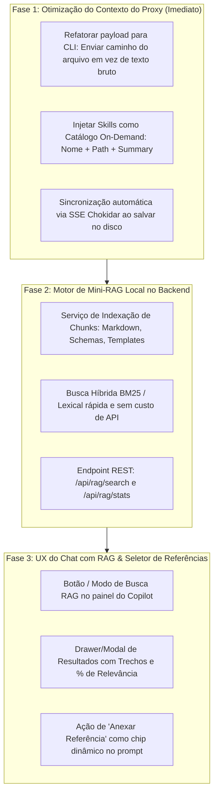

# Plano de Arquitetura: Otimização de Contexto, Skills On-Demand & Mini-RAG Local

Este documento define o plano de implementação em fases para otimização do consumo de tokens, aceleração das respostas dos agentes e introdução de um sistema de RAG local integrado à experiência colaborativa humano-IA.

---

## 1. Visão Geral dos Objetivos

1. **Eficiência Extrema de Tokens (Redução de 70% a 90%):** Deixar de enviar o texto integral bruto dos arquivos e o markdown completo de todas as skills no prompt inicial.
2. **Aproveitamento da Inteligência Nativa dos Agentes CLI:** Fornecer apenas caminhos relativos de arquivos (`filePath`) e índices leves de skills para que o agente (`agy`, `claude`) use suas ferramentas nativas (`view_file`, `replace_file_content`) sob demanda.
3. **Mini-RAG Local (Local Knowledge Discovery):** Indexação local rápida (BM25 + vetorial local) dos documentos do projeto para buscas instantâneas, autocompletion e contexto inteligente no modo Direct API.
4. **Experiência Visual de Busca e Descoberta:** Permitir que o usuário busque termos, veja trechos relevantes dos documentos e decida anexá-los ao contexto do chat com 1 clique.

---

## 2. Fases de Implementação



---

## 3. Detalhamento Técnico das Fases

### Fase 1: Otimização do Proxy CLI e Skills On-Demand

* **Problema Resolvido:** O proxy enviava milhares de linhas de texto do documento ativo + markdowns extensos de skills concatenados a cada turno, inflando os tokens de entrada.
* **Implementação:**
  1. No `ai.routes.ts` e `AntigravityAdapter.ts`:
     * Quando `provider === 'antigravity'` ou `provider === 'claude-code'`:
       * Não enviar o `content` bruto se o `filePath` estiver disponível.
       * Passar no prompt:
         ```text
         [Arquivo Ativo no Workspace: docs/show.mermaid]
         [Skills Selecionadas:
           - design-system (.agents/skills/material-design-system/SKILL.md): Regras de UI e tokens.
         ]
         *Instrução: Use suas ferramentas nativas (view_file, replace_file_content) para ler e alterar o arquivo diretamente no disco quando necessário.*
         ```
  2. No Frontend:
     * Enviar a lista de IDs de skills ativas (`skill_ids`), exibindo chips visuais na barra de contexto.

---

### Fase 2: Motor de Mini-RAG Local no Backend

* **Problema Resolvido:** Permitir busca semântica em dezenas de documentos sem depender de CLI e sem custo de APIs externas.
* **Componentes:**
  1. `server/src/modules/rag/rag.indexer.ts`:
     * Monitora arquivos `.md`, `.json`, `.yaml` e templates no workspace.
     * Divide os arquivos em chunks de 300 a 500 palavras com sobreposição (*overlap*) de 50 palavras.
     * Mantém um índice léxico em memória (MiniSearch / BM25) persistido em cache local.
  2. `server/src/modules/rag/rag.service.ts`:
     * Executa consultas por pontuação de relevância (TF-IDF / BM25 com boost para títulos e tags).
     * Retorna lista de matches: `{ file, section, snippet, score, lineStart, lineEnd }`.
  3. `server/src/modules/rag/rag.routes.ts`:
     * `POST /api/rag/search` -> `{ query: string, repo: string, limit?: number }`
     * `POST /api/rag/reindex` -> Força reindexação do projeto.

---

### Fase 3: UX de Busca RAG no Chat e Painel do Copilot

* **Como o usuário interage:**
  1. **Botão de Busca RAG no Copilot (`find_in_page` / `manage_search`):**
     * Localizado na barra de ferramentas do chat (junto aos botões de Prompt e Skills).
     * Ao clicar ou ao digitar `@documento` ou `/search <termo>`, abre uma barra rápida de busca contextual.
  2. **Card de Resultados com Trechos Destacados:**
     * Mostra os documentos encontrados com badge de similaridade (ex: `94% match`).
     * Exibe o trecho exato do texto encontrado.
  3. **Ações Rápidas por Documento Encontrado:**
     * **👁️ Ver no Editor:** Abre o documento na linha exata.
     * **📎 Anexar ao Chat:** Adiciona o trecho como chip de contexto para o próximo prompt do agente.
  4. **Modo "Auto-RAG" (Toggle no Chat):**
     * Quando ativado, para cada pergunta feita pelo usuário, o sistema roda o Mini-RAG em background e injeta automaticamente os 2-3 trechos mais relevantes antes de responder.

---

## 4. Benefícios Esperados

| Métrica / Recurso | Antes | Depois da Fase 1 | Depois da Fase 2 & 3 (RAG) |
| :--- | :--- | :--- | :--- |
| **Tokens de Entrada por Turno** | 10.000 a 50.000+ | ~1.500 a 2.500 (Constante) | ~2.000 a 3.500 (Com snippets RAG) |
| **Tempo de Resposta Inicial** | 3.5s a 8s | 1.2s a 2s | Instantâneo no Direct API / Rápido no CLI |
| **Busca em Múltiplos Arquivos** | Manual via prompts longos | Agente lê no disco sob demanda | Busca instantânea em 50ms na UI |
| **Controle Humano** | Caixa preta | Total (vê e anexa trechos específicos) | Governança e aprovação visual |
