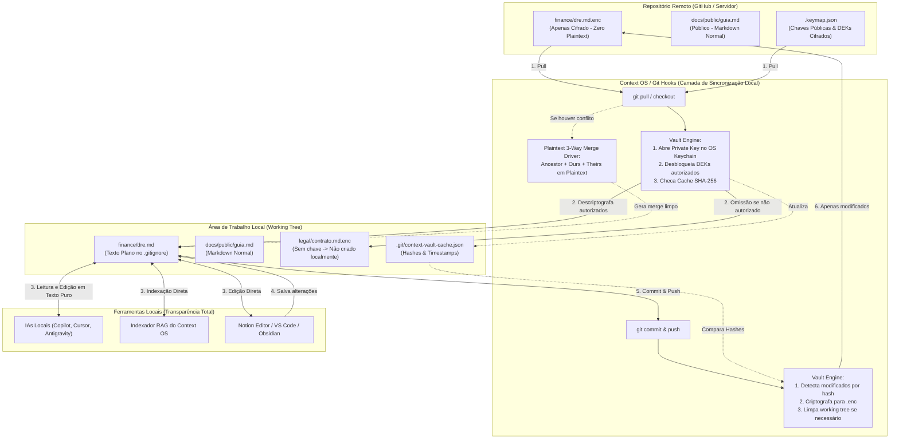

# Plano Arquitetural: Criptografia Transparente no Git, Gestão de Chaves Zero-API e Análise Crítica

> [!TIP]
> **Documento de Referência Arquitetural Permanente**
> Este documento serve como especificação e guia de referência para todas as etapas de implementação da criptografia transparente, descentralizada e compatível com IA no Context OS.

---

## 1. Visão Geral do Ciclo de Vida Transparente

---

## 2. Decisões Arquiteturais Aprovadas

1. **Documentos Públicos (`security_level: 999`)**: Ficam 100% em Markdown puro (`.md`), versionados abertamente no Git sem nenhuma criptografia.
2. **Documentos Confidenciais (`security_level < 999`)**: Adotam o formato `arquivo.md.enc` no repositório Git e `arquivo.md` no disco local do usuário (ignorado via `.gitignore`).
3. **Arquivos Não Autorizados no Disco Local**: Simplesmente **não são gerados** na máquina do usuário sem permissão, mantendo a árvore de pastas limpa.
4. **Resolução de Conflitos**: Quando houver colisão de linhas no mesmo arquivo cifrado, o Context OS abre o **Modal de Conflito Visual** do Notion Editor para o usuário resolver visualmente antes do commit.
5. **Suporte a Pipelines de Deploy (CI/CD)**: Mecanismo de exportação de chaves em variáveis de ambiente (`CONTEXT_VAULT_DEPLOY_KEY`) para GitHub Actions / Vercel descriptografarem a documentação no momento do build.

---

## 3. Gestão Descentralizada de Chaves (Zero-API)

- **Chave Privada X25519 do Usuário**: Gerada uma única vez e guardada no **OS Keychain** via `VaultService`. Nunca vai para o Git.
- **Chave Pública X25519 do Usuário**: Registrada no `.keymap.json` do repositório.
- **DEKs de Compartimento (AES-256-GCM)**: Uma DEK por departamento/nível (ex: `finance`, `engineering`).
- **Slots no `.keymap.json`**: Cifrados pelo Administrador com a chave pública do membro autorizado:
  $$\text{Slot}_{u, d} = \text{Encrypt}_{PK_u}(\text{DEK}_d)$$
- **Cache Local (`.git/context-vault-cache.json`)**: Mantém hashes SHA-256 e mtimes para garantir processamento incremental sub-segundo ($< 10$ms).

---

## 4. Fases de Implementação

- **Fase 1: Motor Criptográfico Assimétrico & Reconciliação (Core Crypto)**
- **Fase 2: Script Autônomo e Motor de Cofre (`.scripts/vault-sync.cjs` e `vault-engine.service.ts`)**
- **Fase 3: Integração com Git Service & Governança (`git.service.ts` e `governance.service.ts`)**
- **Fase 4: Resolução Visual de Conflitos & Integração Frontend (`SecurityContext.tsx` e UI)**
- **Fase 5: Testes Automatizados, Validação de Ponta a Ponta & Walkthrough**
