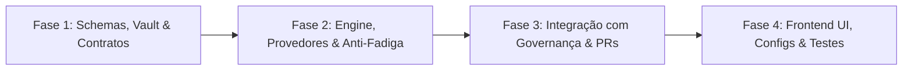

# Sistema de Notificações de Governança (Context OS)
## Plano de Implementação e Arquitetura em Fases

Este diretório contém a documentação técnica, os contratos e o plano de ação detalhado para a implementação do **Sistema de Notificações de Governança** do Context OS.

---

## 📌 Visão Geral do Roadmap

O objetivo é fornecer um sistema de avisos de alta relevância (E-mail e Webhook) focado em **ações humanas** (solicitação de assinaturas de quorum, aprovações e violações de compliance), com salvaguardas rigorosas contra fadiga de alertas (*anti-spam*) e total segurança de credenciais via Vault nativo do SO.

---

## 📂 Fases do Projeto

| Fase | Documento | Status | Objetivo Principal |
| :---: | :--- | :---: | :--- |
| **01** | [phase-01-schema-vault-contracts.md](./phase-01-schema-vault-contracts.md) | 📋 Pronto para Execução | Tipagem TypeScript, extensão do `.project.config.json` e chaves seguras no `VaultService`. |
| **02** | [phase-02-engine-providers-anti-fatigue.md](./phase-02-engine-providers-anti-fatigue.md) | 📋 Planejado | Criação do `NotificationService`, engine de cooldown/deduplicação e provedores (Resend/SMTP/Webhook). |
| **03** | [phase-03-governance-integration.md](./phase-03-governance-integration.md) | 📋 Planejado | Conexão dos gatilhos no `GovernanceService` (solicitação de quorum, aprovação, violações de segredos). |
| **04** | [phase-04-frontend-settings-ux.md](./phase-04-frontend-settings-ux.md) | 📋 Planejado | Interface no Frontend (`Settings > Governança`), disparo de teste e chips visuais dinâmicas. |

---

## 🛡️ Regras de Ouro
1. **Zero Credenciais Expostas:** Nenhuma chave de API ou senha SMTP fica no `.project.config.json` ou no Git; tudo reside no `VaultService` (`@napi-rs/keyring`).
2. **Taxonomias Dinâmicas:** Cores de status, tiers e categorias são lidas dinamicamente do `.project.config.json`.
3. **Prevenção de Fadiga:** Cooldown inteligente e deduplicação de mensagens para evitar poluição da caixa de entrada.
